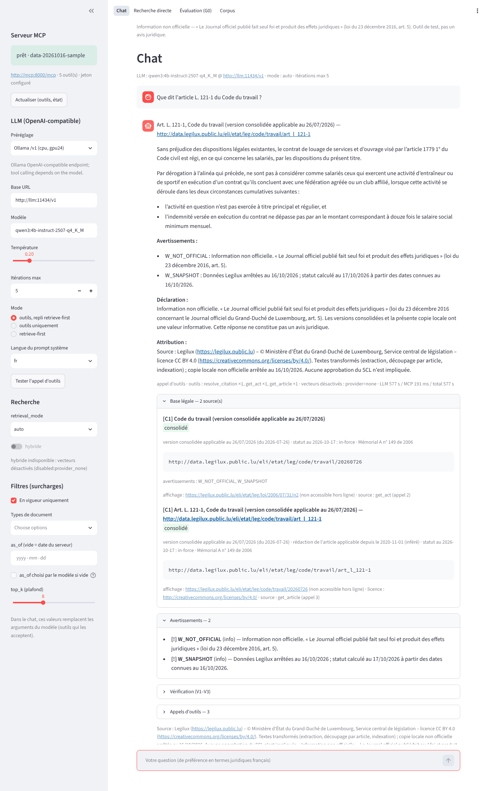
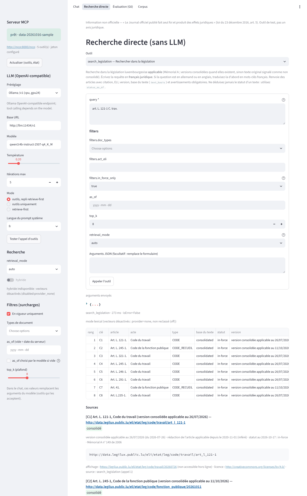
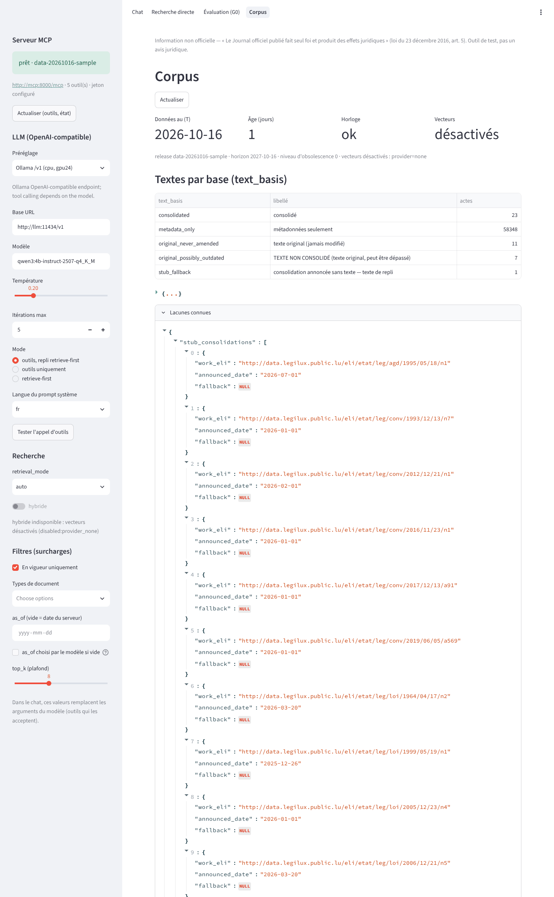

# lgx-streamlit — tester UI (PLAN §9.3)

Streamlit app that drives any OpenAI-compatible Chat Completions model through the MCP tools of `lgx-mcp`,
plus a no-LLM Direct-search tab, the G0 smoke set and a corpus card. It is read-only, has no database
credentials and no server-side chat history, and talks only to the MCP server (`LGX_MCP_URL`, bearer
token) and the configured LLM endpoint. No LLM runtime is bundled: the chat LLM is one external OpenAI-compatible
endpoint, by default the user's Mistral endpoint (Mistral SaaS `https://api.mistral.ai/v1` on a connected host, the
same API under the on-prem domain in the airgap). Embeddings are off: the hybrid toggle stays greyed out while
`vector_status != ok`.

| Path | Role |
|---|---|
| `app.py` | entry: page config, Art. 5 banner (+ a banner naming the host when the LLM endpoint is outside the stack), sidebar, `st.navigation` |
| `pages/1_Chat.py` | tool loop; answer + sources (ELI, version, `text_basis` badge, warnings), V1–V3, tool trace, LLM/MCP latency |
| `pages/2_Direct_search.py` | one form per MCP tool, generated from its `inputSchema` (tools/list is dynamic); rendered + raw JSON |
| `pages/3_Eval.py` | G0 (deterministic tool calls); results as JSON download |
| `pages/4_Corpus.py` | `about_corpus` + `/readyz` |
| `lgx_ui/mcp_client.py` | official `mcp==2.3.0` client, Streamable HTTP, bearer, `trust_env=False`; `/readyz` probe |
| `lgx_ui/llm.py` | official `openai==3.24.0` client (`OPENAI_BASE_URL`); detects endpoints that reject `tools` |
| `lgx_ui/tools_bridge.py` | MCP → OpenAI tools, sidebar hard overrides (schema-scoped), validation, loop, retrieve-first, probe |
| `lgx_ui/render.py` | citation cards, warnings, envelope, latency/vector lines, Streamlit views |
| `lgx_ui/verify_light.py` | turn-local V1–V3 (until `lgx_core.verify`, M4) |
| `lgx_ui/evalg0.py`, `lgx_ui/gold/g0_dev_sample.json` | G0 runner; dev gold set for the 2026-10-16 sample (used when `LGX_EVAL_DIR` has none) |
| `lgx_ui/launch.py` | `python -m lgx_ui.launch`: offline env defaults + disables `net_util.get_external_ip` |
| `.streamlit/config.toml` | offline config (baked into the image; `STREAMLIT_*` variables override per host) |
| `Dockerfile` | image `lgx.local/lgx-streamlit` (build from the repo root) |

## Screenshots

Dev stack on 4 vCPUs with a local OpenAI-compatible test server (`qwen3:4b-instruct-2507-q4_K_M`; details:
`docs/dev/e2e-2026-10-17.md`).

| Chat (answer, sources, warnings) | Recherche directe « art. L. 121-1 C. trav. » | Corpus |
|---|---|---|
|  |  |  |

Retake them with `scripts/ui_browser.cjs` (Playwright, headless Chromium; commands in the e2e document), then
reduce them to 128-colour PNGs (≤ 400 KB each).

## Run

```sh
# Dev stack (db + sample restore + mcp + UI, ports on 127.0.0.1 only), from the repo root
make dev-up                     # = docker compose -f deploy/compose.dev.yml up -d --build --wait
# LLM: Mistral by default; key in secrets/llm_api_key (0600, gitignored), or any OpenAI-compatible URL:
make dev-up LGX_LLM_BASE_URL=https://api.mistral.ai/v1 LGX_LLM_MODEL=mistral-small-latest
make e2e E2E_STUB=1             # scripted chat against scripts/openai_stub.py (keyless, deterministic)

# Host (dev): needs a running lgx-mcp (make mcp → :8001) and an OpenAI-compatible endpoint the host can reach
make ui LGX_LLM_BASE_URL=<url> LGX_LLM_MODEL=<model>      # http://127.0.0.1:8511 (key: LLM_KEY_FILE)
# = cd ui && LGX_MCP_URL=… LGX_MCP_TOKEN=… OPENAI_BASE_URL=… LGX_LLM_MODEL=… uv run python -m lgx_ui.launch

# Image only
docker build -f ui/Dockerfile -t lgx.local/lgx-streamlit:dev .       # --secret id=ca_bundle,src=… behind a TLS proxy
```

Environment (Appendix C names): `LGX_MCP_URL`, `LGX_MCP_TOKEN_FILE` (or `LGX_MCP_TOKEN` in dev),
`OPENAI_BASE_URL` (default `https://api.mistral.ai/v1`), `OPENAI_API_KEY_FILE` (or `OPENAI_API_KEY`), `LGX_LLM_MODEL`
(default `mistral-small-latest` [U]), `LGX_LLM_TRUST_ENV` (0; 1 = through the environment's HTTPS proxy),
`LGX_MAX_TOOL_ITERATIONS` (5), `LGX_MCP_TIMEOUT_S` (20), `LGX_LLM_TIMEOUT_S` (120), `LGX_TOOL_RESULT_TOKENS`
(4000; dev compose 2500), `LGX_TURN_BUDGET_S` (600), `LGX_EVAL_DIR`, `LGX_HOSTNAME`. A `*_FILE` that cannot be read
stops the UI at start (`UiSettingsError`; airgap secrets must be readable by uid 10001). The sidebar's Base URL and
model can point the chat at any OpenAI-compatible endpoint; the configured API key is only sent to the configured
base URL, never to a URL typed into the sidebar. Without a sidebar
`as_of`, an `as_of` chosen by the model is ignored (server date) unless the question names that date as a point in
time (« au 1er janvier 2020 », not « loi du 1er août 2018 ») or « as_of choisi par le modèle si vide » is ticked; the
model is told in the tool message when its date was replaced. Tool results are cut to `LGX_TOOL_RESULT_TOKENS` without
ever dropping or shortening a warning (`compact_json`: text and snippets first, then machine-only fields, warning data
lists beyond 5 entries, then trailing hits).

## Tests

```sh
uv run pytest -q tests/unit/test_ui_*.py    # bridge, MCP client (in-process + ASGI HTTP), render, AppTest, sentinel, compose
```

`openai` and `mcp` use `httpx2`, which `respx` cannot intercept: the fake OpenAI server is an
`httpx2.MockTransport`; `respx` covers the plain-httpx `/readyz` probe.
